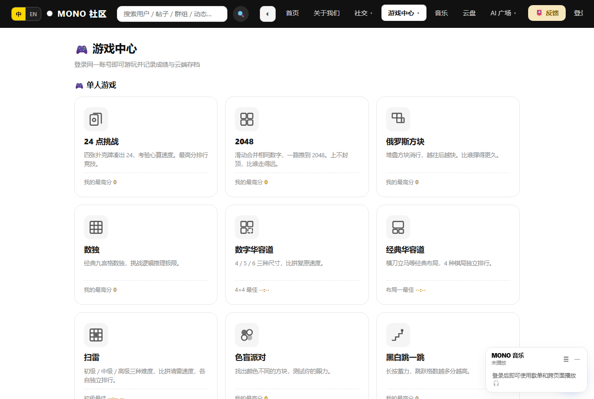
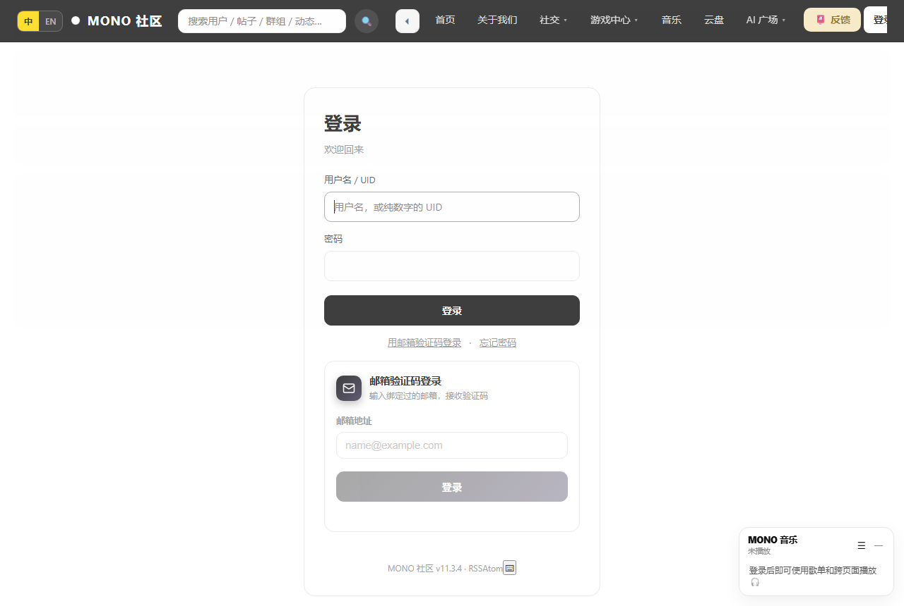

# MONO 社区

[](https://github.com/wsy2026-ops/mono/actions/workflows/ci.yml)

一个自己写的社区网站：论坛、群聊、六款棋盘对战、在线判题（OJ）、积分商城、AI 广场、音乐台。

Flask + SQLite 单进程，**能跑在一台 2 核 2G 的小服务器上** —— 没上 Redis 集群，没上消息队列，
所有功能都在一个进程里，部署就是 `scp` + `systemctl restart`。

代码量：Python 约 4.8 万行（99 个文件），模板约 4.8 万行（142 个），界面文案中英双语。

> 这是一个**真实在跑**的站点，不是教学 demo。所以里面有不少「为什么这么写」的注释 ——
> 大多是踩过坑之后补的，比如「这里必须用 copytruncate，否则日志轮转会杀掉进程」。
> 觉得啰嗦可以删，但删之前建议先看看它在防什么。





> 截图来自一个**全新初始化的空库**，不是线上站点，所以看不到任何真实用户数据。

---

## 功能

**社区**
- 论坛：板块、标签、精华、投票、举报、编辑历史、相关推荐
- 群聊 / 私信 / 动态 / 好友 / 群组（含群文件、公告、禁言、入群审核）
- 通知中心、@ 提及、站内搜索

**游戏**
- 20+ 小游戏：2048、俄罗斯方块、数独、扫雷、华容道、汉诺塔、24 点…
- 六款棋盘对战：中国象棋、国际象棋、五子棋、围棋、黑白棋、揭棋
  - 支持 PvP（房间/匹配）与 PvAI
  - AI 可挂外部引擎（Pikafish / Stockfish / KataGo / RAPFI / Egaroucid），
    探测不到就自动降级到内置 AI
  - 全部支持复盘回放
- 象棋大师：带血条、攻击范围、行动点的变体规则

**OJ**
- 题库、比赛、提交记录、测试点管理
- 判题机是独立进程（`mono-oj`），跟主站分开跑，判题挂了不影响社区

**积分经济**
- 签到、任务、商城（头衔/徽章/气泡/特效）、扭蛋、积分账本
- 幂等入账（`idem_key`），防重复发放

**AI 广场**
- 多家大模型转发（智谱 / DeepSeek / Moonshot），按 token 计费、余额、兑换码
- 英文界面下会自动要求模型用英文回答

**其他**
- 音乐台、云盘、成就墙、排行榜、完整后台管理
- PWA（可加到主屏）、深浅色主题、移动端底部导航

---

## 技术栈

| | |
|---|---|
| Web | Flask 2.x + Flask-SocketIO（长轮询）+ waitress |
| 数据 | SQLite（WAL，`busy_timeout=5000`）；可选 PostgreSQL 影子库做只读分流 |
| 前端 | 服务端渲染 Jinja2 + 原生 JS，无构建步骤 |
| 判题 | 独立进程，`systemd` 单服务 |
| 国际化 | 自建 `i18n/`（点分 key + JSON，中英双语，含 JS 弹窗） |

**为什么是 SQLite**：这个站点的并发量（几十人同时在线）用 SQLite 完全够，
省掉一个数据库进程就省掉一份运维。真要扩容，`pg_shadow.py` 里已经有向 PostgreSQL 迁移的路径。

---

## 快速开始

```bash
git clone <this-repo> mono && cd mono
python -m venv .venv && source .venv/bin/activate    # Windows: .venv\Scripts\activate
pip install -r requirements-render.txt              # Python 3.11+ 用这份（见下）

python scripts/init_db.py --admin admin 你的密码    # 建表（145 张）+ 建第一个超管
python start_server.py                              # 本地跑，默认 http://127.0.0.1:5000
python start_server.py --check-only                 # 只做环境自检，不启动
```

> **两份依赖清单的区别**：`requirements.txt` 是给一台老机器（Python 3.7 / 32 位 Windows）锁的；
> `requirements-render.txt` 给 Python 3.11+，额外锁死了 flask 2.2.5 的传递依赖
> （不锁的话新版 werkzeug 会把 flask 2.2 带崩）。**新环境用后者。**

表结构在 `schema.sql`（从线上库导出的完整结构，已改成幂等）。
数据库默认在项目根的 `data.db`（**已在 .gitignore 里，不会进仓库**）。

⚠️ **不要用 `app.init_db()`** —— 那是早期的建库函数，里面全是裸 `ALTER` 和非幂等 `UPDATE`，
在空库上会中途报错（缺表），在非空库上会误改数据。函数自带护栏会拒绝执行，
但正确的入口是 `scripts/init_db.py`。

生产环境用 `wsgi.py`（waitress，数据目录可配），参考 `infra/` 里的 systemd / nginx / logrotate 配置。

---

## 配置

全部走环境变量，**代码里没有任何默认密钥**。

| 变量 | 作用 | 必填 |
|---|---|---|
| `MONO_SECRET_KEY` | Flask session 签名密钥（不设则读/生成 `.secret_key`） | 建议设 |
| `MONO_DATA_DIR` | 数据目录（放 `data.db` 和上传文件），默认代码同目录 | 否 |
| `PORT` / `MONO_BIND` | 监听端口 / 地址，默认 `8080` / `127.0.0.1` | 否 |
| `MONO_ADMIN_SALT` / `MONO_ADMIN_HASH` | 管理员通行证（PBKDF2）。**不设则 `/become-admin` 直接拒绝** | 需要时 |
| `ZHIPU_API_KEY` / `DEEPSEEK_API_KEY` / `MOONSHOT_API_KEY` | AI 广场的模型密钥 | 用 AI 时 |
| `MONO_RESEND_KEY` / `MONO_RESEND_FROM` | Resend 发信（注册验证码、日报、告警） | 用邮件时 |
| `MONO_SMTP_HOST` / `_PORT` / `_USER` / `_PASS` / `_FROM` | SMTP 兜底通道 | 否 |
| `GITHUB_OAUTH_CLIENT_ID` / `_SECRET` | GitHub 第三方登录 | 否 |
| `MONO_REPORT_TO` | 日报收件人 | 否（不设就不发） |
| `MONO_ALERT_EMAIL` | 告警收件人 | 否（不设就不发） |
| `MONO_TG_TOKEN` / `MONO_TG_CHAT` | Telegram 告警 | 否 |
| `MONO_PG_DSN` / `MONO_PG_SHADOW` / `MONO_PG_READ` | PostgreSQL 影子库（实验性） | 否 |

生成管理员通行证：

```bash
python admin_secret.py --gen
# 按提示输入两遍，把输出的 MONO_ADMIN_SALT / MONO_ADMIN_HASH 写进环境变量
```

---

## 棋类引擎（可选）

引擎**不在仓库里**（加起来 400MB，而且都是别人的软件）。
不装也能玩，AI 会降级到内置的简单实现。

```bash
bash scripts/download_engines.sh check   # 看缺什么
bash scripts/download_engines.sh info    # 来源 + 许可证
```

| 引擎 | 用途 | 许可证 |
|---|---|---|
| Pikafish | 中国象棋 | GPL-3.0 |
| Stockfish | 国际象棋 | GPL-3.0 |
| KataGo | 围棋 | MIT |
| RAPFI | 五子棋 | GPL-3.0 |
| Egaroucid | 黑白棋 | AGPL-3.0 |
| GNU Go | 围棋兜底 | GPL-3.0 |

⚠️ **本仓库的 MIT 许可证不覆盖这些引擎。** 它们各自独立，由你自己下载、自己遵守各自的协议；
本项目只通过子进程调用，不链接、不修改。

---

## 目录结构

```
app.py              主应用（路由 + 业务）
board/              六款棋盘对战（规则 / 引擎 / 回放 / 协议）
games/              小游戏 + 统一提交协议 + 存档适配器
games_verify/       服务端复算（防前端改分）
chat/               聊天室、私信、Socket 事件
xqm/                象棋大师（变体规则 / 匹配 / 赛季 / 抽奖）
ojweb/              OJ 的 Web 层（判题机在独立进程）
adminpanel/         后台
i18n/               中英文案（zh.json / en.json / js_en.json）
templates/          142 个 Jinja2 模板
static/             前端资源
infra/              systemd / nginx / logrotate / 部署校验脚本
scripts/            运维脚本（含引擎下载）
docs/               设计文档（棋类 UI 规范、PWA 方案等）
```

**关于 `app.py` 很大**：项目是从单文件长起来的，2026-10 做过一轮拆包
（`chat/ games/ board/ xqm/ ojweb/ adminpanel/`），主文件仍然很大。
再拆要动路由注册，收益不大就一直没做 —— 阅读时按路由名搜索，别通读。

---

## 已知取舍

- **没有数据库自动迁移**：加表/加列靠 `CREATE TABLE IF NOT EXISTS` + `_add_column()`，
  不引 Alembic。小项目、改动少，够用。
- **SocketIO 用长轮询**，不是 WebSocket：为了在只开放 80/443 的环境里也能跑。
- **没有单元测试**。有 `tests/smoke.py`（空库建表 → 渲染 13 个页面 → 检查内联 JS 语法）
  和 `infra/verify.sh`（部署后 7 项校验），CI 跑前者。但没到逐函数覆盖的程度。
- **中文注释占多数**。作者中文母语，写的时候没打算给谁看；开源后保留原样。

---

## 测试

```bash
python tests/smoke.py      # 建库 → 渲染 13 个页面 → 检查内联 JS 语法
```

CI（`.github/workflows/ci.yml`）跑的就是这条，外加 Python 语法检查和「有没有把密钥/数据库误提交」的扫描。

---

## 许可证

代码用 **MIT**，见 [LICENSE](LICENSE)。

第三方组件（棋类引擎、字体、图标）各自遵循自己的许可证，见上表和各自目录里的说明。
